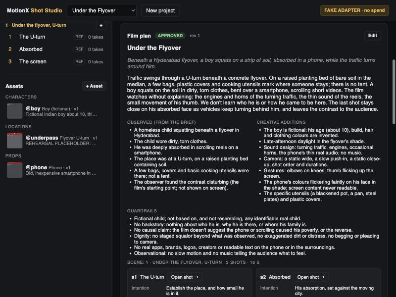
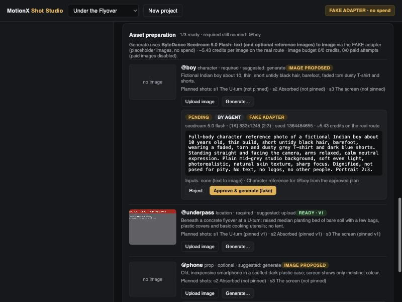
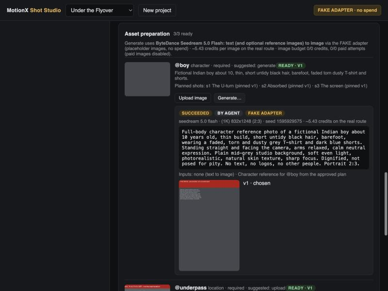

# Demo approval brief: "Under the Flyover"

**Status (2026-10-21):** implemented and rehearsed **offline only**. No live LLM, image or video call has been made for this demo, and none is enabled. All caps are 0 by default; the `.env` paid video attempt is already used (1/1). Each stage below needs its own explicit approval. Existing balances and keys do not count as approval.

**Positioning:** an open-source, Comfy-powered directing workspace: describe an idea, plan shots, prepare references, approve generation, revise with preserved creative decisions. We don't claim these concepts are unique (Higgsfield documents AI directing, script breakdown, reusable assets and human-triggered generation); our angle is an open, local, inspectable implementation on Comfy workflows.

---

## 1. Treatment and shot list (for your review)

This plan was **hand-written by me as the rehearsal mock** (`demo/flyover/agent_mock.json`), not produced by a model. In Stage A the live agent drafts its own; you would compare, edit and approve.

**Logline.** Beneath a Hyderabad flyover, a boy squats on a strip of soil, absorbed in a phone, while the traffic turns around him.

**Treatment.** Traffic swings through a U-turn beneath a concrete flyover. On a raised planting bed of bare soil in the median, a few bags, plastic covers and cooking utensils mark where someone stays; there is no tent. A boy squats on the soil in dirty, torn clothes, bent over a smartphone, scrolling short videos. The film watches without explaining: the engines and horns of the turning traffic, the thin sound of the reels, the small movement of his thumb. We don't learn who he is or how he came to be here. The last shot stays close on his absorbed face as vehicles keep turning behind him, and leaves the contrast to the audience.

| Observed (your brief) | Creative additions (mine) |
|---|---|
| A homeless child squatting beneath a flyover in Hyderabad | The boy is fictional; age (about 10), build, hair, clothing colours invented |
| Dirty, torn clothes | Late-afternoon daylight in the flyover's shade |
| Deeply absorbed in scrolling reels on a smartphone | Sound design: traffic, engines, horns, the phone's thin audio; no music |
| At a U-turn, on a raised planting bed containing soil | Camera: static wide, slow push-in, static close-up; order and durations |
| A few bags, covers, basic cooking utensils; not a tent | Gestures: elbows on knees, thumb flicking up the screen |
| You found the contrast disturbing (the starting point, not shown) | The phone's colours faintly on his face; screen content never readable; specific utensils (blackened pot, pan, steel plates) |

**Guardrails** (in the plan and recorded as decisions):
- The boy is fictional and doesn't resemble any real child.
- No backstory: who he is, why he's there, his family.
- No suggestion that the phone or scrolling caused his poverty, or the reverse.
- Dignity: no staged squalor beyond what you observed, no exaggerated dirt or distress, no begging or pleading to camera.
- No real apps, brands, logos, creators or readable text.
- No slow motion or music telling the audience what to feel.

| Shot | Action | Camera | Duration | Sound | Assets |
|---|---|---|---|---|---|
| **s1 The U-turn** | Vehicles swing through the U-turn. On the raised soil bed, bags, covers and utensils sit near @boy, squatting, head bent over a phone | wide · static · natural day | 5 s | traffic, engines, an occasional horn; no music | @boy, @underpass |
| **s2 Absorbed** | @boy squats, elbows on knees, thumb flicking up the screen; vehicles pass behind, softly out of focus | medium → medium close-up · slow push-in ("very slow, even pace") | 6 s | traffic slightly softer; the phone's thin reel audio becomes audible; no music | @boy, @underpass, @phone |
| **s3 The screen** | Close on @boy's absorbed face, the phone's colours faint on his skin; he keeps scrolling as vehicles pass, out of focus | close-up · static | 5 s | the phone's audio close and thin over traffic; a distant horn; no music | @boy, @phone, @underpass |

No direction warnings. Total 16 s. Video estimates on the real route: s1 135.78, s2 162.94, s3 135.78 credits. **Only s1 is in this approval.**

## 2. Reference previews and what's missing

| Asset | Status now | Source | Notes |
|---|---|---|---|
| **@underpass** (location, required) | **missing**: no location image was supplied anywhere I could find | **upload** (preferred) | Put your own photo at `demo/flyover/underpass.jpg`. Ideally it shows the U-turn, the raised soil bed and the flyover. Avoid identifiable faces and legible number plates. A generated fallback prompt is below |
| **@boy** (character, required) | **missing** | generate | Fictional child; prompt below |
| **@phone** (prop, optional) | **missing** | generate | Used in s2/s3 only |

Rehearsal screens (all FAKE outputs, clearly labelled):
- the plan as you'd review it: 
- a pending image proposal showing the exact prompt, model, size, seed, inputs and estimate *before* approval: 
- after approval and choice, all three ready (grey FAKE images and a labelled location placeholder): 

## 3. Exact proposed image prompts

**@boy**, 832×1248 (2:3), no input references:
> Full-body character reference photo of a fictional Indian boy about 10 years old, thin build, short untidy black hair, barefoot, wearing a faded, torn and dusty grey T-shirt and dark blue shorts. Standing straight and facing the camera, arms relaxed, calm neutral expression. Plain mid-grey studio background, soft even light, photorealistic, natural skin texture, sharp focus. Dignified, not posed for pity. No text, no logos, no other people. Portrait 2:3.

**@phone** (optional), 1024×1024 (1:1):
> Reference photo of an old, inexpensive smartphone in a scuffed dark plastic case, screen on and showing only indistinct bright colours (no app interface, no text, no logos), lying on a plain grey surface, soft even light, photorealistic. Square 1:1.

**@underpass**, a fallback **only if you have no photo**, 1424×800 (16:9):
> Eye-level wide photograph beneath a concrete city flyover in Hyderabad, India, at a U-turn: a raised median planting bed of bare brown soil with a few cloth bags, folded plastic covers and basic cooking utensils (a blackened aluminium pot, a pan, steel plates) on it; no tent; no pedestrians; auto-rickshaws, motorbikes and cars turning around the median in the background, motion-blurred; late-afternoon daylight in the flyover's shade; dusty, stained concrete pillars. Photorealistic, natural colour, no readable signs, no logos, no text. 16:9.

**Your call:**
- A photoreal generated child in hardship is the most sensitive item. The provider may refuse or alter it (untested).
- **Alternatives** if you prefer: an illustrated style for all assets, or shots that keep the boy's face less prominent (from the side or behind in s1/s2).

## 4. Chosen workflows and settings

| Purpose | Workflow | Settings | Price source | Estimate |
|---|---|---|---|---|
| Asset images | `seedream_flash_image`: ComfyUI `ByteDanceSeedreamNodeV3`, model "seedream 5.0 flash" (templates `api_bytedance_seedream_5_0_flash_t2i`/`_image_edit`, MIT) | 1K presets above; one image per run; random seed; watermark off; 0–10 refs | Node price badge, ComfyUI 0.42.1 `comfy_api_nodes/nodes_bytedance.py`: flat $0.02574/image | **5.43 credits** (≈ $0.026) per image |
| Video s1 | `h3_reference`: `MinimaxHailuo03ReferenceNode` (MiniMax H3) | 5 s, 768P, 16:9, Image 1 = @boy, Image 2 = @underpass | Node price badge: $0.1287/s at 768P; +$0.0572 per image over 5 | **135.78 credits** (≈ $0.64) |
| Agent | Gemini `gemini-3.8-flash` (Interactions API, no retries, thinking low) | per stage below | `studio/agent/pricing.py`: $0.75 / $3.75 per 1M tokens (dated table); calculated cost labelled `gemini.v2` (conservative, tool-use billing inferred) | per stage below |

- **Why Seedream 5.0 Flash:** the cheapest official image option I found in the installed templates. It does text-to-image and multi-reference in one node.
- **Others compared** (same price-badge source):
  - Nano Banana 2 1K ≈ $0.048 + thinking;
  - Nano Banana 2 Lite $0.0408;
  - FLUX.2 [pro] from $0.03 (+refs);
  - FLUX 3 1K $0.069;
  - Seedream 5.0 Pro 1K $0.045.
- **Validation:** ComfyUI accepts the graph offline with 0, 2 and 10 references.
- **Limitations:**
  - no real output has been seen yet;
  - the charge isn't confirmed;
  - text rendering isn't relied on;
  - the seed doesn't guarantee repeatability.

Reference-to-video stays direct: references go straight into H3. No intermediate start frame is composed.

## 5. Staged live calls, budgets and stop points

All stages run in a **new data folder** (`data-flyover-live`), so the real paid take (`data/`) and the Gemini history (`data-live1/`) are untouched. Caps there start from an empty ledger, so each cap equals new spend. I set the variables for one stage, run it once, reset them to 0, and **stop for your review**. Fixed rules for every stage:
- no automatic retries;
- no provider fallback;
- no Anthropic calls;
- a failed call is reported, not repeated.

| Stage | Calls | Verifies | Expected cost | Proposed hard caps (separate budgets) | Stop for review with |
|---|---|---|---|---|---|
| **A: plan** | Gemini: 1 `models.get` metadata check (no tokens), then **one agent session** of about 4–6 requests: read brief/skill/decisions, `write /plan` | A live model drafts a valid plan through the nested `write /plan` schema (untested on Gemini); keeps observed vs added separate; respects the guardrails; invents no backstory | **$0.02–0.06** | LLM: `STUDIO_AGENT_BUDGET_USD=0.15`, `MAX_LIVE_REQUESTS=8`, `MAX_OUTPUT_TOKENS=4096`, `THOUGHT_ALLOWANCE=4096`, `MAX_TURNS=8`. Image and video caps 0 | the draft plan next to the mock above; you edit/approve |
| **B: asset prompts** *(optional)* | Gemini: one session, about 3–4 requests: read `/preparation`, propose images for "generate" assets | The agent proposes only what's needed, with exact prompts, and can't approve. **Skip it** if you'd rather click Generate with the plan's prompts (zero LLM cost) | **$0.01–0.03** | LLM: cumulative `BUDGET_USD=0.23`, `MAX_LIVE_REQUESTS=14` | the pending image proposals |
| **C: images** | Comfy Seedream 5.0 Flash: @boy ×1 and @phone ×1, plus @underpass ×1 **only if you have no photo**; a second @boy try only if you ask. Balance read before/after (free) | First real image run through proxy → ComfyUI → Partner Node; the real charge vs 5.43; the output saved as an *unreviewed* version; how the provider handles the character prompt | **10.86 credits** (2 images); up to 21.72 with the fallback and one retry | Image: `STUDIO_IMAGE_BUDGET_CREDITS=22`, `STUDIO_IMAGE_MAX_PAID_ATTEMPTS=4`. Video cap 0 | the images; you choose or reject each |
| **D: first video** | Optionally Gemini, one tiny session (≤ 3 requests) to propose s1, **or** you click Propose (no LLM). Then **one H3 reference take of s1**. Balance before/after | First real reference-to-video with photoreal references (2 images); consistency of @boy and the place; observed charge vs 135.78 | **135.78 credits** (+ ≤ $0.02 if the agent proposes) | Video: `STUDIO_BUDGET_CREDITS=140`, `STUDIO_MAX_PAID_ATTEMPTS=1`. LLM cumulative `BUDGET_USD=0.28`, `MAX_LIVE_REQUESTS=17` | the take; you write the real feedback |

**Totals if every stage runs:**
- LLM: at most **$0.28** (expected $0.03–0.11).
- Images: at most **22 credits** (≈ $0.10; expected 10.86).
- Video: at most **140 credits** (≈ $0.66; expected 135.78).
- Worst case about **$1.04**. The Comfy balance (919.22 credits at last read on 2026-10-20) would drop by about 147–162 credits.

**Why the LLM caps sit above the expected cost:** the app checks each request against the cap using a pre-call *estimate* of about $0.035 per request, assuming full output and thinking. The cap has to leave that headroom; actual spend is expected to be far lower. If a stage hits the cap early, I report it and don't raise the cap.

**After Stage D (not in this approval):**
- Revision feedback on s1. Any example feedback stays **provisional** until we watch the real take: say "he shouldn't look at the camera", "less traffic motion", or "hold longer before he scrolls".
- s2 and s3 takes.
- The demo video.

## 6. Smallest first stage to authorise

**Stage A only.** It's one Gemini planning session: at most 8 requests, a $0.15 cap, expected about $0.03. It makes no image or video calls and leaves you a draft plan to compare with the mock. Suggested wording: *"Approve Stage A with the caps in the brief."*

In parallel, at no cost: drop a location photo into `demo/flyover/underpass.jpg` if you have one. That removes the location from Stage C.

## 7. Rehearsal record (fake only)

`scripts/demo.py rehearse` against a fake-only app with the replay mock. Every agent call went through the real tools.

1. **Idea:** project + four decisions.
2. **Plan:** the mock agent read the brief, skill and decisions, then `write /plan` → revision 1, **draft**.
3. **Approval:** a person approved revision 1. That created the scene and shots s1–s3 and listed 3 required assets (all **missing**).
4. **Location:** uploaded a labelled placeholder ("REHEARSAL PLACEHOLDER – not the real location") → chosen, pinned to s1–s3.
5. **Asset images:** the mock agent proposed @boy and @phone (Seedream 5.0 Flash, ~5.43 credits each) → **pending**.
6. **Images approved:** a person approved both (FAKE images with a red banner) and chose them → pinned (@boy to s1–s3, @phone to s2–s3). All 3 **ready**.
7. **First video:** the mock agent proposed s1 → **pending** proposal (~135.78 credits on the real route), with Image 1 = @boy, Image 2 = @underpass. **Not approved; no take.**

Also checked in the browser:
- approving and choosing images by clicking;
- editing the plan to revision 2, which then shows "changed since approval".
