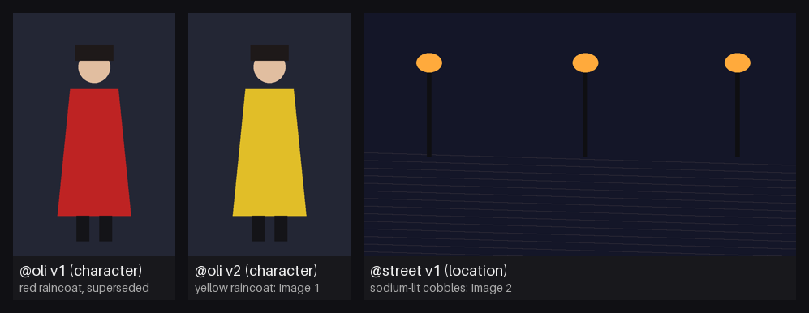
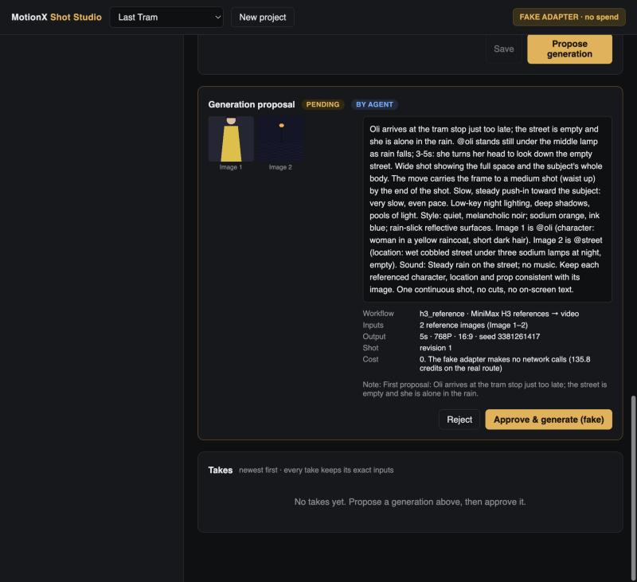

# M5 demo: approval brief

**Status:** prepared and rehearsed with fake outputs only. **Nothing below has been run live.** No Gemini, Anthropic or paid Comfy call has been made since live run 1 (2026-10-20). Both spending locks are still at 0 by default, and the paid attempt in `.env` is used (1/1).

Each stage below needs its own explicit go-ahead. A balance or key in `.env` does not count as approval.

---

## 1. Demo concept: "Last Tram"

> Oli misses the last tram home and walks into the rain. **Scene 1, tram stop at night:** she arrives just too late; the street is empty and the only company is the rain and the lamps.

- **Direction:** quiet, melancholic noir; sodium orange and ink blue; rain-slick reflective surfaces.
- **Recorded decision:** "No score anywhere in the film; diegetic sound only." The agent has to respect it.
- **Why this story:** one location, one character, and weather and light that H3 handles well. It also reuses the assets and route we have already verified (run 1 was a night street with a push-in).

### Reference previews (all rights-clear)

| Asset | Version | Used as | Rights |
|---|---|---|---|
| `@oli` character | v1, red raincoat (superseded) | shows asset versioning | synthetic, drawn in this repo with PIL; no real person's likeness |
| `@oli` character | **v2, yellow raincoat** | **Image 1** | same |
| `@street` location | **v1**, cobbles under three sodium lamps | **Image 2** | same |

I also looked at the images in the other MotionX folders, such as the landing-page art in `MotionX-Studio-Frontend/public/landing`. I didn't use them, because their source and rights aren't recorded.

### What the real model did with these kinds of images (run 1, our one paid take)

Run 1 (first-frame mode, synthetic flat frame, "slow push-in") gave three results:
- The model **kept the flat graphic style**.
- It added a small flicker in one window.
- The push-in was **barely visible**: the frame grows by a few percent over 5 s.

Expect the same from these references: a clean, stylised result rather than a cinematic one.
Rights note: these frames are model output from our paid run. Check Comfy's and MiniMax's output terms before publishing them.

### Better images would help, but I haven't generated any

The current references are blocky shapes. In particular, `@oli` has **no facial features**, so a "close-up on her face" revision has nothing to hold on to. **What's missing:**

| Needed | Why | Prompt you can use (generate, commission or shoot it yourself) |
|---|---|---|
| `@oli` v2, full body | readable identity and face for consistency and the close-up | *Full-body character reference of an adult woman in her early 30s, short dark bob haircut, knee-length yellow rubber raincoat, dark trousers, black ankle boots. Standing straight, facing camera, arms relaxed, neutral expression. Plain mid-grey studio background, soft even light, photorealistic, sharp focus. No text, no logos, no other people. Portrait 2:3.* |
| `@oli` v1 (optional) | keeps the versioning beat | the same prompt with *deep red raincoat* |
| `@street` location plate | the place needs a tram stop, which the current plate lacks | *Empty European side street at night after rain: wet cobblestones reflecting three sodium-vapour street lamps, tram tracks down the centre, a small glass tram-stop shelter on the right, closed shopfronts, light drizzle. No people, no vehicles, no readable signage or text. Eye-level wide view, 16:9, photorealistic, cinematic noir, sodium orange and ink blue.* |

- **Rights:**
  - Use your own photo or illustration, or a commission with a written licence.
  - If you generate the images, use a service whose terms give you the output; that would be a separate paid call needing its own approval.
  - A real person needs a signed release.
  - Keep all three images in one style, either all photoreal or all illustrated.
- **To use them:** save them with the same file names (`asset_oli_v1.png`, `asset_oli_v2.png`, `asset_street.png`) in a folder, then run `scripts/demo.py seed --images <folder>`. Any file that's missing falls back to `samples/`.

---

## 2. Proposed first shot

This is drafted by the agent in Stage A. Below is what the **scripted stand-in** produced in rehearsal; the live model may choose differently, and I'll show you exactly what it chose before any video is generated.

| Setting | Value |
|---|---|
| Workflow | `h3_reference` (MiniMax H3 references → video) |
| References | Image 1 = `@oli` v2, Image 2 = `@street` v1 |
| Output | 5 s, 768P, 16:9, random seed |
| Framing | wide → **ends at** medium (waist up); `push_in`, "very slow, even pace" |
| Lighting | `low_key_night` |
| Sound | "Steady rain on the street; no music" (from the brief and the decision) |
| Estimate | **135.78 credits ≈ $0.64** (5 s × 27.156; 2 images, so no surcharge for more than 5) |

**Compiled prompt (exact):**

> Oli arrives at the tram stop just too late; the street is empty and she is alone in the rain. @oli stands still under the middle lamp as rain falls; 3-5s: she turns her head to look down the empty street. Wide shot showing the full space and the subject's whole body. The move carries the frame to a medium shot (waist up) by the end of the shot. Slow, steady push-in toward the subject: very slow, even pace. Low-key night lighting, deep shadows, pools of light. Style: quiet, melancholic noir; sodium orange, ink blue; rain-slick reflective surfaces. Image 1 is @oli (character: woman in a yellow raincoat, short dark hair). Image 2 is @street (location: wet cobbled street under three sodium lamps at night, empty). Sound: Steady rain on the street; no music. Keep each referenced character, location and prop consistent with its image. One continuous shot, no cuts, no on-screen text.

**Expected result (honest):**
- **Likely:** a figure in a yellow raincoat on a dark street with orange lamps, in a stylised or flat look close to the references, plus rain sound.
- **Uncertain:**
  - whether the turn happens around 3 s;
  - whether the push-in is visible (run 1's was minimal);
  - whether "no music" is respected (H3 always generates audio);
  - whether both references are used. Reference-to-video has **never run on the real model**.
- **Possible failures:** an identity that ignores the blocky reference; a medium end size that isn't reached; unwanted text or artifacts.

---

## 3. Journey and what is real vs. rehearsed

| # | Step | Who | Rehearsed (fake) | Live plan |
|---|---|---|---|---|
| 1 | References: brief, assets, decision, scene | person | ✓ `scripts/demo.py seed` | same seed, in a new data dir `data-demo-live` |
| 2 | Agent drafts the first shot and a pending proposal | agent | ✓ scripted stand-in (9 tool calls) | **Stage A: Gemini** |
| 3 | Approve → take 1 | person | ✓ FAKE clip | **Stage B: H3 take 1** |
| 4 | Feedback on take 1 | person | ✓ **provisional placeholders**: "Too fast. Push in slower and end on her face." / "Make it feel more cinematic." | written by you after watching the real take |
| 5 | Agent revises the shot and proposes again | agent | ✓ end framing medium → close-up, 5 → 7 s (+54.31 credits, stated); asked about the vague note instead of inventing an edit | **Stage C: Gemini** |
| 6 | Approve → take 2 (child of take 1) | person | ✓ FAKE clip | **Stage D: H3 take 2** |
| 7 | Compare side by side, review, select | person | ✓ | offline |
| 8 | Export the selected take + manifest | person | ✓ 1 file + `manifest.json`, hashes verified | offline |

Rehearsal screenshots: [agent first shot](demo/rehearsal_2_agent_first_shot.jpg) · [agent revision](demo/rehearsal_5_agent_revision.jpg) · [compare](demo/rehearsal_7_compare.jpg) · [export](demo/rehearsal_8_export.jpg).

Every fake clip carries a red **"FAKE OUTPUT - placeholder, not a model result"** banner burned into the video, and the UI shows FAKE badges. The live demo runs in its **own data dir**, so the real paid take (`data/`) and the Gemini test history (`data-live1/`) stay untouched.

---

## 4. Planned live calls, costs and caps

All four stages run against `data-demo-live`, which starts with an empty spend ledger. That's why the caps below are absolute values for that data dir. Each stage's settings are placed in the environment by me, then reset to 0 once the stage stops.

| Stage | Call(s) | Purpose | Expected cost | Proposed hard cap (app-enforced) |
|---|---|---|---|---|
| **A** | Gemini `gemini-3.8-flash`: one `models.get` metadata check (no tokens), then **one agent session**, typically 5–7 requests | Agent drafts shot 1 from the references and proposes | **$0.02–0.05** calculated (run 1: 5 requests, $0.010–0.019) | `STUDIO_AGENT_MAX_LIVE_REQUESTS=8`, `STUDIO_AGENT_BUDGET_USD=0.10`, `MAX_OUTPUT_TOKENS=2048`, `THOUGHT_ALLOWANCE=4096`, `THINKING=low`, `MAX_TURNS=8`, no retries; video caps 0 |
| **B** | Comfy: balance read (free); optional keyless probe of the reference graph (rejected with 401, $0); **one H3 reference take** | First real reference-to-video take | **135.78 credits ≈ $0.64** | `STUDIO_BUDGET_CREDITS=140`, `STUDIO_MAX_PAID_ATTEMPTS=1`; LLM caps 0 |
| **C** | Gemini: **one agent session**, typically 5–8 requests | Revise from your real notes on take 1 | **$0.02–0.05** | cumulative `MAX_LIVE_REQUESTS=16`, `BUDGET_USD=0.20`; video caps stay at 1/1, so nothing can be approved |
| **D** | Comfy: **one H3 take** (child of take 1), plus a balance read | Real two-take revision | **135.78–190.09 credits** (5–7 s) ≈ $0.64–0.90 | cumulative `STUDIO_BUDGET_CREDITS=330`, `STUDIO_MAX_PAID_ATTEMPTS=2`. A proposal over 190.1 credits (more than 7 s) is refused by the cap, and I stop and ask |

**Proposed total caps:**
- LLM: **≤ $0.20 and ≤ 16 requests** (expected $0.04–0.10).
- Video: **≤ 330 credits and ≤ 2 takes** (expected 271.6–325.9 credits ≈ $1.29–1.54).
- Comfy balance: now 919.22. After both takes it should be about 593–648.

**Fixed rules:**
- No automatic retries, no second sessions within a stage, no provider fallback.
- No Anthropic calls; none are planned.
- No image generation; better images are your call, see §1.
- If a take fails, I report and stop; I don't retry.
- The LLM cap uses pre-call estimates of about $0.03 per request. A stage can stop early on the cap even when the actual spend is lower. I'd report that, not raise the cap.
- Calculated LLM cost uses `gemini.v2`, which is conservative. The tool-use billing in it is *inferred*. Confirmed cost only comes from your billing console.

## 5. What each stage verifies, and where I stop

| Stage | Verifies | Stop for your review with |
|---|---|---|
| A | the live model follows the new "first shot" section of the skill: refs ordered character → location, intention not invented, explicit `end_framing`, no direction warnings left unexplained; image tool results with 2 assets; `gemini.v2` accounting with tool-use tokens recorded | the shot fields, the compiled prompt, the tool-call list, reported and calculated usage. **No approval until you say so.** |
| B | `h3_reference` (node 4, two `LoadImage` clones) end to end on the real Partner Node; observed charge vs. 135.78 estimate; output saved and immutable | the take video, the observed charge, the balance before/after. **You write the real feedback.** |
| C | live adherence to the revision rules on real notes: smallest coherent change, cost stated for any duration change, vague notes answered with a question, `parent_take_id` set | the diff, the new prompt and estimate, the agent's message |
| D | the first real revision chain: take 2 linked to take 1, side-by-side comparison, export of the selected take with its manifest | both takes, the charge, the export ZIP. Then we decide on recording |

---

## 6. Demo video outline (≤ 2:00)

| Time | Beat | On screen |
|---|---|---|
| 0:00–0:10 | Hook | "Shot Studio: open-source shot-making on ComfyUI. The agent proposes; a person approves every paid generation." |
| 0:10–0:25 | References | Brief, `@oli` v1 → v2 (costume update), `@street`, the "no score" decision |
| 0:25–0:45 | Agent proposal | Type the request; tool calls stream (reads skill and assets, writes shot, proposes). Pending proposal shows Image 1/2, prompt, **≈135.8 credits** |
| 0:45–1:00 | Approval → take 1 | Approve; status moves queued → running → ready; play the real take |
| 1:00–1:12 | Human feedback | Type the real notes (the ones in this brief are placeholders) |
| 1:12–1:30 | Agent revision | Field diff (e.g. end framing, duration +2 s, **+54 credits** stated); the agent asks about any vague note instead of guessing; approve |
| 1:30–1:45 | Compare | Take 1 and take 2 side by side; select take 2 |
| 1:45–1:55 | Export | Export preview, ZIP with `manifest.json`: exact inputs, asset versions, hashes, cost certainty |
| 1:55–2:00 | Close | Route diagram (MotionX → comfy-sdk → comfy-api-proxy → ComfyUI → MiniMax H3) and repo name |

Record only with real takes. If a fake clip ever appears, its burned-in banner stays visible.

## 7. Changes made in this preparation (all offline)

- **Direction rules:**
  - Still **refused**, because the input can't be honoured or the prompt would be impossible: an end framing without a start; push-in ending wider or pull-out ending tighter; an end framing on a static camera; camera detail without a move; timed beats past the duration; length limits.
  - Now **warnings**, accepted, shown in the editor and returned to the agent: restating the move; a combined move or zoom/crane mentioned in camera detail; "ends on her eyes" without `end_framing`; end equal to start; a pan or tilt changing size.
- **The scripted stand-in can now draft a scene's first shot** (references → shot → pending proposal), and the skill has a "Drafting the first shot of a scene" section.
- **Fake clips** carry a burned-in FAKE banner.
- **UI:** duration offers every supported value from 4 to 15 s; it previously showed a 7 s shot as "4s". The agent panel has its own column and no longer covers take cards.
- **`scripts/demo.py`:** `seed` / `rehearse` (with `--stop-after N` and `--images DIR`). It refuses to rehearse unless the app reports the fake adapter and the scripted agent.

## To approve

Reply per stage, e.g. "Approve Stage A" (or A–D with the caps above, stopping after each). Changes to the concept, shot or caps are easy before anything runs.
